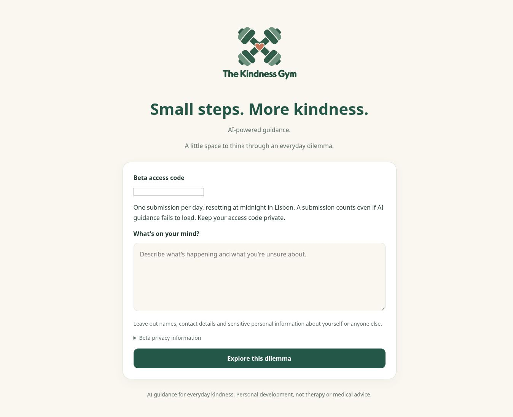

# The Kindness Gym

An AI guide to help people think through everyday dilemmas and practise kindness towards themselves and others through small, realistic actions.

Developed by David Gill as an Ironhack final capstone. The app supports personal development; it is not therapy, medical advice or an emergency service.

## Project at a glance

| Question | Answer |
| --- | --- |
| Problem | Turn an everyday dilemma into a manageable action while respecting uncertainty, personal boundaries and financial limits. |
| Solution | A FastAPI app with AI guidance, separately selected research cards, private beta access and persistent usage limits. |
| Skills demonstrated | Requirements definition, prompt iteration, workflow integration, evaluation, deployment and operational planning. |
| Evidence | A documented hosted deployment, a 14-case application regression run and an explicit record of content failures and remaining checks. |
| Current limit | A controlled MVP; usefulness, sustained behaviour change and readiness for wider use remain unproven. |



*Hosted interface captured on 19 November 2026. No access code or personal dilemma was entered.*

## My contribution and use of AI

I developed this project as my Ironhack final capstone, using AI assistance for coding and review. My focus was defining the product behaviour and boundaries, iterating the prompts, connecting the application and beta-access workflow, and checking the results against documented criteria.

The repository records both working features and unresolved findings. Response reviews assisted by ChatGPT are labelled as assisted reviews; they are not independent assessments. The project demonstrates an AI implementation process rather than a claim that I wrote every line of code independently.

### Start with the evidence

- [Evaluation results and known failure patterns](evaluation/mvp_langsmith_results.md)
- [Beta setup, access controls and deployment checks](mvp/README.md)
- [Proposed pilot and readiness work](deployment/round2_pilot_plan.md)
- [Cost and ROI assumptions](cost_estimation/round2_roi_analysis.md)

## Current status: Round 2 hosted MVP

The FastAPI app was deployed on 8 October 2026. Hosted AI guidance, private tester access and the daily submission limit have been checked manually.

- [Live app](https://the-kindness-gym.onrender.com/) — a valid private beta access code is required to submit a dilemma.
- [Round 2 presentation](https://docs.google.com/presentation/d/13qKwBTc_Ezx4IsB0cpECYZm9SLOteHz_u2CO7xDgFqM/edit)
- [App documentation](mvp/README.md)

The MVP is available for controlled demonstration. Wider tester recruitment is pending the remaining evaluation and privacy/provider checks. Deployment does not establish production readiness, GDPR compliance or real-world effectiveness.

## What the MVP does

- Accepts an everyday dilemma, up to 4,000 characters.
- Generates a balanced perspective and practical kindness suggestions using `gpt-5.6-luna`, with reasoning effort set to `none`.
- Displays grounded Radical gratitude observations, with omission intended for detected crisis situations.
- May display one relevant research card from a curated collection of three studies, with a fixed summary and source link.
- Provides a loading state, input validation, error messages and optional feedback through Google Forms.

Research selection and citation display are handled by code separately from the model. The selected study is not supplied to the model as retrieved context. The app has no saved conversation history, progress tracking, payments or implemented 21-day programme.

## Deployment and beta access

Render hosts the Python/FastAPI app in Frankfurt. Neon PostgreSQL, also in Frankfurt, stores tester reference IDs, access-code hashes, active status and submission dates and timestamps. The database does not store dilemma text or AI replies.

Before calling OpenAI, the app validates the tester code and reserves a submission:

- One submission per access code per Lisbon calendar day, resetting at midnight.
- An overall cap of 20 submissions per day is implemented, but has not yet been specifically tested.
- Failed AI requests also count towards the daily limit.
- Usage records persist across app restarts and deployments.
- Access codes can be revoked by removing the tester and their usage records.

Codes are private bearer credentials, not verified personal identities. Sharing a code shares its access and daily allowance. A reference number identifies the tester record and does not grant access.

The teacher approved use of the Ironhack API key for the hosted beta. Operation remains subject to the available API allowance.

## Configuration

Python is pinned to `3.14.2` in `.python-version`. App dependencies are listed in `mvp/requirements.txt`.

Local configuration uses `mvp/.env`; hosted configuration uses Render environment variables:

| Variable | Purpose |
| --- | --- |
| `OPENAI_API_KEY` | Server-side OpenAI API credential |
| `DATABASE_URL` | PostgreSQL connection string for beta access and usage records |

Never commit `.env`, API keys, database passwords, access codes or private tester lists. Existing database tables are required for submissions; see the app documentation for setup and administration.

From the repository root, with the virtual environment active and configuration set:

```powershell
python -m pip install -r mvp/requirements.txt
python -m uvicorn mvp.main:app --port 8001
```

Open `http://127.0.0.1:8001/`. The `/health` endpoint returns `{"status":"ok"}` to confirm the app process is running; it does not verify database or OpenAI availability.

Render configuration:

```text
Root directory: repository root (leave the field blank)
Build command: pip install -r mvp/requirements.txt
Start command: python -m uvicorn mvp.main:app --host 0.0.0.0 --port $PORT
Health check path: /health
```

The free hosting service can sleep when idle. Allow time for it to wake before a demonstration.

## Evaluation and verified checks

The 6 October Round 2 evaluation used 14 fictional cases. All 14 passed each of three automated checks: non-empty guidance returned, expected research display, and expected gratitude display. Recorded model response times were 2.98–4.94 seconds. These checks do not establish advice quality or overall safety.

An assisted content review of two replies found unnecessary extra checking after an already-corrected mistake and speculation about future reconnection after a no-contact boundary. The other twelve replies still need content review.

Manual deployment checks completed on 8 October:

- Local and hosted health endpoints returned OK.
- Invalid tester codes were rejected before an AI request.
- A valid hosted submission returned AI guidance.
- A second submission with the same code was blocked.
- Usage created locally was recognised by the hosted app after deployment.
- A temporary tester's access and usage records were removed, and their code was subsequently rejected.
- The privacy summary and contact address displayed on the hosted app.

The overall daily cap, simultaneous-request behaviour and broader outage/error scenarios still require testing.

### Offline error-message checks

With the app dependencies and `httpx` installed, run:

```powershell
python -m unittest discover -s tests -v
```

These regression checks replace OpenAI and database access with fakes. They verify that provider failures and empty replies explain the consumed daily allowance and the midnight Lisbon reset. They do not exercise the real database or establish wider readiness.

## Privacy and remaining readiness work

The app displays a privacy summary and asks users to omit identifying and sensitive personal information. The beta contact is `davidstevengill+beta_testers@gmail.com`. Testers should use their reference number for record-related requests and should not email their dilemma or secret code.

The notice commits to deleting access and usage records within 30 days after the beta ends. Individual removal is implemented and tested; the end-of-beta cleanup procedure still needs documenting and carrying out. Provider records and backups are separate from deletion in the app database.

OpenAI requests use `store=False`, which does not guarantee zero provider retention. EU hosting does not establish that all downstream processing stays in the EU. Provider/account responsibilities, applicable processing terms, lawful basis, sensitive-data handling, transfer safeguards, security review and DPIA screening remain open. Email and Google Forms feedback are additional data flows to assess.

See [the Round 2 GDPR assessment](research/gdpr_assessment_round2.md) and [EU AI Act assessment](research/eu_ai_act_assessment_round2.md). These are preliminary assessments, not compliance certifications.

## Research and proposed pilot

The survey export used for the updated Round 2 presentation contains 116 responses. It is a convenience sample from the author's network, not a representative study or proof of market demand.

The proposed next stage is a small, controlled six-week pilot after readiness checks, measuring usefulness and repeat use. Reminders, tracking and a possible 21-day programme remain future options to test through feedback. See [the pilot plan](deployment/round2_pilot_plan.md).

## Earlier work: Round 1

Round 1 explored the opportunity through sector and competitor research, business charts, a survey, an n8n proof of concept and preliminary cost, timeline and regulatory assessments.

The earlier n8n POC used `gpt-4o-mini`. Its five-case manual evaluation had two clean passes and three failures, a 40% pass rate on that small set. Those historical findings informed Round 2; they are not the current FastAPI MVP's evaluation score.

- [Round 1 presentation](https://docs.google.com/presentation/d/199wH7lWeK8QR4vg8MJe64yAaN16EzRtSOEQMnu4UT4I/edit)
- [n8n POC documentation](n8n/poc/README.md)
- [Preliminary Green AI assessment](research/green_ai_assessment.md)

Actual electricity consumption and carbon emissions have not been measured. The product has not been validated for demand, willingness to pay or sustained behaviour change.

## Repository structure

| Directory | Contents |
| --- | --- |
| `mvp/` | FastAPI app, prompt, research selection, interface and beta access logic |
| `deployment/` | Round 2 pilot planning |
| `evaluation/` | Test cases, model comparisons, evaluation scripts and results |
| `research/` | Studies, survey analysis, market research and regulatory assessments |
| `charts/` | Tableau workbook, chart data and source notes |
| `cost_estimation/` | Cost, timeline and commercial planning |
| `n8n/` | Earlier proof-of-concept workflow and documentation |
| `feedback/` | Round 1 feedback and decisions |
| `presentation/` | Presentation supporting materials |

Portfolio presentation updated 19 November 2026. Historical deployment and model-evaluation results above retain their original October dates; they have not been rerun for this documentation update.
